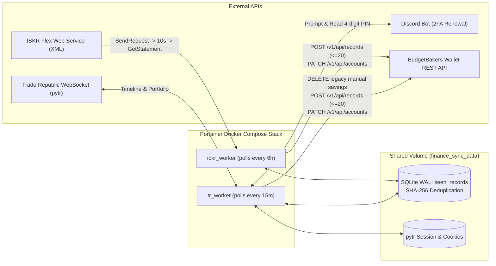

# `finance-sync` — IBKR & Trade Republic to BudgetBakers Wallet Sync

A modular, containerized Python homelab service that automatically syncs financial transactions, stock/ETF trades, savings plans, 1% Saveback rewards, dividends, interest, and live portfolio mark-to-market valuations from **Interactive Brokers (IBKR)** and **Trade Republic** into **BudgetBakers Wallet**.

Built with **[Astral `uv`](https://docs.astral.sh/uv/)**, strict **`mypy`** type checking, **`ruff`** linting/formatting, an ultra-minimal **Alpine Linux** multi-stage Docker image, and an **AI-agent-native** repository structure powered by [Matt Pocock's (`aihero.dev`) agent skills](https://www.aihero.dev/).

---

## Architecture & Data Flow



### Key Features
1. **Interactive Brokers (`ibkr_worker`)**:
   - Executes two-step polling (`SendRequest` -> wait 10s -> `GetStatement`) against the IBKR Flex Web Service and parses Activity Flex Query XML via `ibflex2`.
   - Logs settled stock/ETF trades (e.g., `FAKE`) with executed shares, ISIN, symbol, and price embedded in `note`:
     `BUY 5.0000 sh XF0000000001 (FAKE) @ 100.00 EUR`
   - Logs dividends and broker interest (`CashTransactions`), while skipping SEPA deposits/withdrawals (already paired via Revolut bank-sync in Wallet).
   - Patches the investment account's live market value (`OpenPositions` + ending cash) via `PATCH /v1/api/accounts`.
2. **Trade Republic (`tr_worker`)**:
   - Maintains a persistent `pytr` session in `/app/data`. When 2FA expires, sends an interactive verification prompt to your **Discord channel** via a Discord Bot, reads your 4-digit reply, completes login, and saves refreshed cookies automatically.
   - Splits events across your **Trade Republic Cash** (`BB_TR_CASH_ACCOUNT_ID`) and **Trade Republic Wealth** (`BB_TR_WEALTH_ACCOUNT_ID`) accounts:
     - **Card payments** (newer than `TR_CARD_CUTOFF_DATE`): Logged as expenses on Cash with automatic merchant keyword + MCC categorization (e.g., Supermarket/Grocery -> `Groceries`, Burger Diner/Restaurant -> `Restaurants & fast food`, Coffee Shop/Cafe -> `Bar cafe`, Steam -> `Software, apps, games`).
     - **Monthly interest**: Logged as income (`Interest, dividends`) on Cash.
     - **1% Saveback**: Logged as bonus income (`Interest, dividends`) on Wealth with shares, ISIN, and price in `note`.
     - **Savings plans & stock buys**: Deducts cash on Cash AND logs the security purchase (with shares, ISIN, and price in `note`) on Wealth.
     - **Portfolio valuation**: Patches live portfolio market value onto Wealth via `PATCH /v1/api/accounts`.
3. **SHA-256 SQLite Deduplication (`shared/database.py`)**:
   - Uses SQLite in WAL mode (`seen_records` table) with deterministic hash:
     `sha256(broker + external_id + timestamp + f"{float(amount):.2f}")`
4. **First-Class Mock Data & Dry-Run Mode**:
   - Set `USE_MOCK_DATA=true` to run the entire stack against realistic synthetic IBKR Flex XML and Trade Republic JSON fixtures (`tests/fixtures/`).
   - Set `DRY_RUN=true` to log all intended BudgetBakers writes without mutating your live Wallet account.

---

## Prerequisites & Obtaining Credentials

### 1. BudgetBakers Wallet API Token & Account UUIDs
1. Open the [BudgetBakers Wallet web app](https://web.budgetbakers.com/) -> **Settings** -> **API Tokens** (requires Wallet Premium) and generate a token.
2. Fetch your account UUIDs using your `BUDGETBAKERS_TOKEN` environment variable:
   ```bash
   curl -s -H "Authorization: Bearer ${BUDGETBAKERS_TOKEN}" \
     "https://rest.budgetbakers.com/wallet/v1/api/accounts" | python -m json.tool
   ```
3. Note the `id` values for `BB_IBKR_ACCOUNT_ID`, `BB_TR_CASH_ACCOUNT_ID`, and `BB_TR_WEALTH_ACCOUNT_ID`.

### 2. Interactive Brokers Flex Web Service
1. Log in to **IBKR Client Portal** -> **Performance & Reports** -> **Flex Queries**.
2. Create an **Activity Flex Query** with output format **XML** including sections:
   - `Trades` (Execution level)
   - `Cash Transactions`
   - `Open Positions` (Summary)
   - `Cash Report`
3. Note the **Query ID** (`IBKR_FLEX_QUERY_ID`).
4. Under **Settings** -> **Flex Web Service**, enable the service and generate your **Flex Web Service Token** (`IBKR_FLEX_TOKEN`).

### 3. Trade Republic & Discord 2FA Bot
1. Go to the [Discord Developer Portal](https://discord.com/developers/applications) -> **New Application** -> **Bot**.
2. Enable **Message Content Intent** under Privileged Gateway Intents, copy the **Bot Token** (`DISCORD_BOT_TOKEN`), and invite the bot to your private homelab Discord server with `Send Messages` and `Read Message History` permissions.
3. Copy the target channel ID (`DISCORD_CHANNEL_ID`).

---

## Local Development & Testing (with `uv`)

### 1. Install Dependencies
```bash
uv sync --all-groups
```

### 2. Run in Mock / Dry-Run Mode (Zero Credentials Needed)
```bash
USE_MOCK_DATA=true DRY_RUN=true uv run python -m ibkr_worker.worker --once
USE_MOCK_DATA=true DRY_RUN=true uv run python -m tr_worker.worker --once
```

### 3. Run Quality Checks & Full Test Suite
```bash
# Formatter check
uv run ruff format --check .

# Linter, type-annotation & bandit security check
uv run ruff check .

# Strict static type check
uv run mypy .

# Unit, Integration, and End-to-End tests with coverage
uv run pytest --cov=config --cov=shared --cov=ibkr_worker --cov=tr_worker --cov-report=term-missing -v
```

---

## Deploying on Portainer (Homelab)

1. Push this repository to GitHub. The GitHub Actions workflow (`.github/workflows/ci.yml`) automatically runs `ruff`, `mypy`, `pytest`, `gitleaks`, and publishes the Alpine image to `ghcr.io/mevljas/finance-sync:latest`.
2. In **Portainer**:
   - Navigate to **Stacks** -> **Add stack**.
   - Select **Repository** (or paste the contents of [`docker-compose.yml`](./docker-compose.yml)).
   - Under **Environment variables**, add the variables from [`.env.example`](./.env.example):
     - `FINANCE_SYNC_IMAGE=ghcr.io/mevljas/finance-sync:latest`
     - `BUDGETBAKERS_TOKEN=...`
     - `BB_IBKR_ACCOUNT_ID=...`
     - `BB_TR_CASH_ACCOUNT_ID=...`
     - `BB_TR_WEALTH_ACCOUNT_ID=...`
     - `IBKR_FLEX_TOKEN=...`
     - `IBKR_FLEX_QUERY_ID=...`
     - `TR_PHONE_NO=+49...`
     - `TR_PIN=...`
     - `DISCORD_BOT_TOKEN=...`
     - `DISCORD_CHANNEL_ID=...`
   - Click **Deploy the stack**.
3. On first startup, `tr_worker` will post a 2FA prompt in your Discord channel. Reply with the 4-digit code from your Trade Republic app to persist the session in the `finance_sync_data` volume.

---

## AI-Agent-Native Workflow (`aihero.dev`)

This repository is structured for coding agents:
- **[`AGENTS.md`](./AGENTS.md)** / **[`CLAUDE.md`](./CLAUDE.md)**: Primary agent entrypoint, hard invariants, and commands.
- **[`docs/PRD.md`](./docs/PRD.md)**, **[`docs/ARCHITECTURE.md`](./docs/ARCHITECTURE.md)**, **[`docs/GLOSSARY.md`](./docs/GLOSSARY.md)**, **[`docs/adr/`](./docs/adr/)**: Persistent domain context and Architecture Decision Records.
- **[`.agents/skills/`](./.agents/skills/)**: Modular Matt Pocock (`aihero.dev`) skills (`grill-me`, `grill-with-docs`, `write-a-prd`, `to-spec`, `to-tickets`, `tdd`, `code-review`, `retro`, `handoff`).
