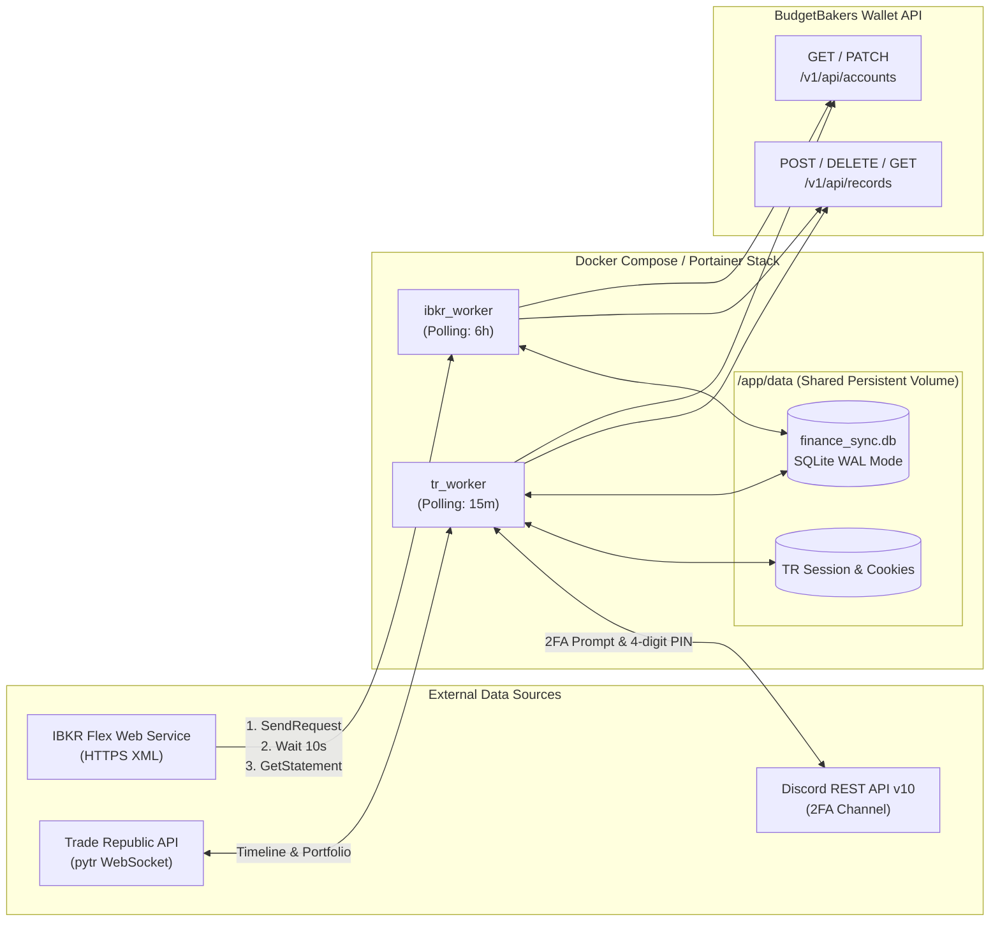

# System Architecture (`finance-sync`)

## 1. High-Level Topology

## 2. Module Boundaries

### `config/settings.py`
- Centralizes all environment configuration using `pydantic_settings.BaseSettings`.
- Holds the deterministic merchant-to-category mapping rules for Trade Republic card transactions.
- Exposes `use_mock_data` and `dry_run` flags.

### `shared/database.py`
- Encapsulates SQLite connection management with `PRAGMA journal_mode=WAL;` and `PRAGMA busy_timeout=5000;` so `ibkr_worker` and `tr_worker` can safely read/write the shared `/app/data/finance_sync.db` concurrently.
- Provides `compute_record_hash(broker, external_id, timestamp, amount)` using `hashlib.sha256`.
- Manages `seen_records` and `sync_metadata` tables.

### `shared/budgetbakers.py`
- Wraps `httpx.Client` with Bearer JWT authentication and automatic `429 Retry-After` backoff.
- Enforces BudgetBakers API batch constraints:
  - `POST /v1/api/records`: chunks into slices of at most `20` items.
  - `DELETE /v1/api/records`: chunks into slices of at most `10` IDs.
  - `PATCH /v1/api/accounts`: computes `initialBalance = round(target_balance - totalIncomes + totalExpenses, 2)` and sends `[{"id": account_id, "initialBalance": initialBalance}]`.

### `ibkr_worker/`
- `flex_client.py`: Executes the two-step IBKR Flex Web Service protocol (`FlexClient`) and parses the resulting XML bytes via `ibflex2` (`parse_flex_xml`) into typed `IBKRStatementData`, `IBKRTradeEvent`, and `IBKRCashEvent` models.
- `worker.py`: Orchestrates polling (`IBKRWorker`), per-batch SQLite deduplication, record creation on `BB_IBKR_ACCOUNT_ID`, and live portfolio balance patching.

### `tr_worker/`
- `session_manager.py`: Wraps `pytr` session persistence in `/app/data` (`TRSessionManager`) and implements `Discord2FAClient` using Discord REST API v10 to request and read a 4-digit 2FA verification PIN when the session expires.
- `event_parser.py`: Pure functional parser (`parse_tr_timeline_events`, `parse_tr_portfolio_value`) converting raw Trade Republic timeline & portfolio JSON payloads into typed `ParsedTRRecord` (`TRRecordKind`) objects with target account routing (`cash` vs. `wealth`), category resolution, and stock buy `note` formatting.
- `worker.py`: Orchestrates one-time backfill reconciliation (`TRWorker`, deleting legacy `-50 EUR` manual savings plan placeholders and seeding existing manual interest entries), syncs new timeline events per batch, and patches `BB_TR_WEALTH_ACCOUNT_ID` balance.
