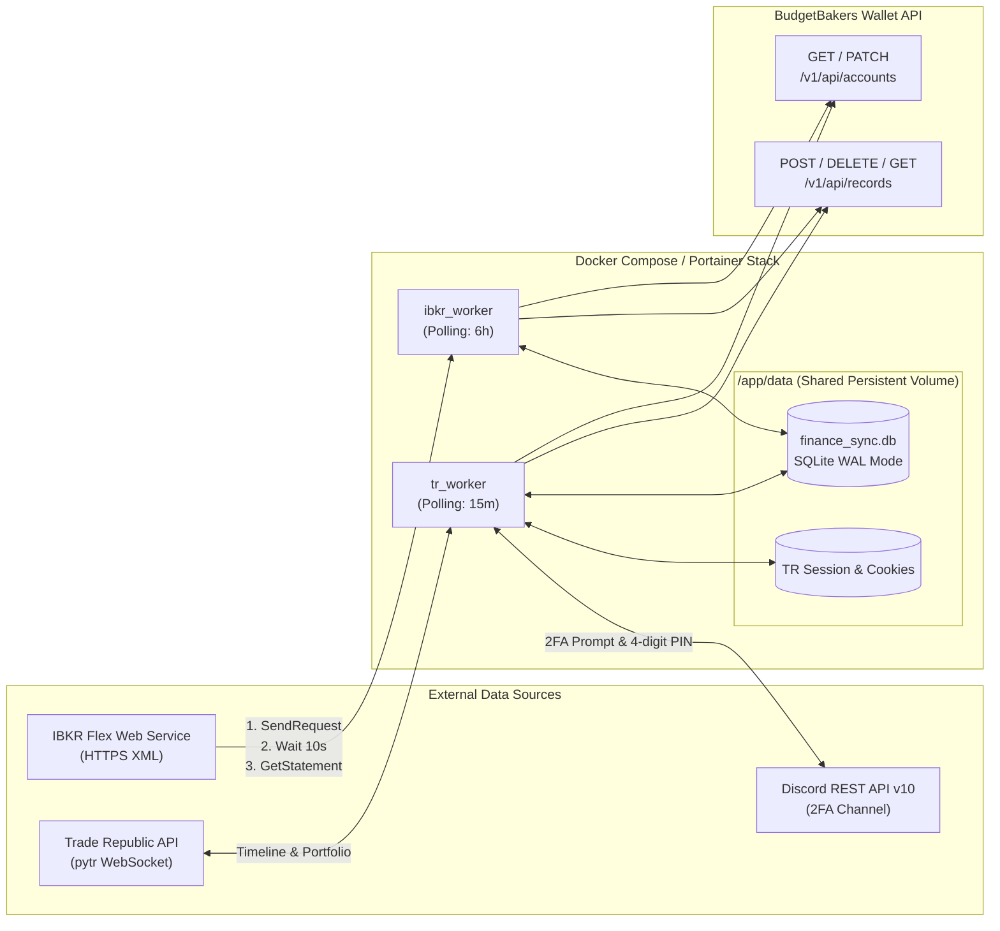

# System Architecture (`finance-sync`)

## 1. High-Level Topology

## 2. Module Boundaries

### `config/settings.py`
- Centralizes all environment configuration using `pydantic_settings.BaseSettings`.
- Holds the deterministic merchant-to-category mapping rules for Trade Republic card transactions.
- Exposes `use_mock_data` and `dry_run` flags.

### `shared/database.py`
- Encapsulates SQLite connection management with `PRAGMA journal_mode=WAL;` and `PRAGMA busy_timeout=5000;` so `ibkr_worker` and `tr_worker` can safely read/write the shared `/app/data/finance_sync.db` concurrently.
- Provides `compute_record_hash(broker, external_id, timestamp, amount)` using `hashlib.sha256`.
- Manages `seen_records` and `sync_metadata` tables.

### `shared/budgetbakers.py`
- Wraps `httpx.Client` with Bearer JWT authentication and automatic `429 Retry-After` backoff.
- Enforces BudgetBakers API batch constraints:
  - `POST /v1/api/records`: chunks into slices of at most `20` items.
  - `DELETE /v1/api/records`: chunks into slices of at most `10` IDs.
  - `PATCH /v1/api/accounts`: computes `initialBalance = round(target_balance - totalIncomes + totalExpenses, 2)` and sends `[{"id": account_id, "initialBalance": initialBalance}]`.
- Supports read-only **Dry-Run Mode** (`dry_run=True`): blocks all `POST`, `DELETE`, and `PATCH` mutations while recording preview payloads (`dry_run_created`, `dry_run_deleted_ids`, `dry_run_patched_accounts`) and performing read-only `GET` queries (with offline stub fallback when `use_mock_data=True`).

### `ibkr_worker/`
- `flex_client.py`: Executes the two-step IBKR Flex Web Service protocol (`FlexClient`), parses XML bytes via `ibflex2` (`parse_flex_xml`) into typed `IBKRStatementData`, `IBKRTradeEvent`, `IBKROpenPosition`, and `IBKRCashEvent` models (converting `OpenPositions` to base currency via `fxRateToBase` and skipping internal `assetCategory="CASH"` FX conversion rows), and merges multi-year historical XML statements (`merge_statement_data`).
- `worker.py`: Orchestrates polling (`IBKRWorker`), optional full account record purge (`--purge-account-records`) or targeted deletion from a local gitignored JSON file (`--delete-file`), local historical XML file/directory ingestion (`--xml-file`), CouchDB stock holdings sync (`CouchDBStockSyncClient`), automatic existing-record seeding on fresh SQLite volumes, record creation on `BB_IBKR_ACCOUNT_ID`, live uninvested cash balance patching, and CLI flags (`--once`, `--dry-run`, `--dry-run-output`, `--purge-account-records`, `--delete-file`, `--xml-file`).

### `tr_worker/`
- `session_manager.py`: Wraps `pytr` session persistence in `/app/data` (`TRSessionManager`) and implements `Discord2FAClient` using Discord REST API v10 to request and read a 4-to-6-digit 2FA verification code when the session expires.
- `event_parser.py`: Pure functional parser (`parse_tr_timeline_events`, `parse_tr_portfolio_value`, `parse_tr_stock_trades`, `parse_tr_live_positions`) converting raw Trade Republic timeline & portfolio JSON payloads into typed `ParsedTRRecord` (`TRRecordKind`) and `StockTradeInput` objects with target account routing (`cash` vs. `wealth`), paired `Transfer` creation, category resolution, and stock buy `note` formatting.
- `worker.py`: Orchestrates initial existing-record seeding (`TRWorker`), optional full account purge (`--purge-account-records`) or targeted deletion from a local gitignored JSON file (`--delete-file`), syncs new timeline events and CouchDB stock holdings per batch (skipping SQLite/CouchDB mutations in dry-run mode), patches `BB_TR_WEALTH_ACCOUNT_ID` balance, and supports `--once`, `--dry-run`, `--dry-run-output`, `--purge-account-records`, and `--delete-file`.
